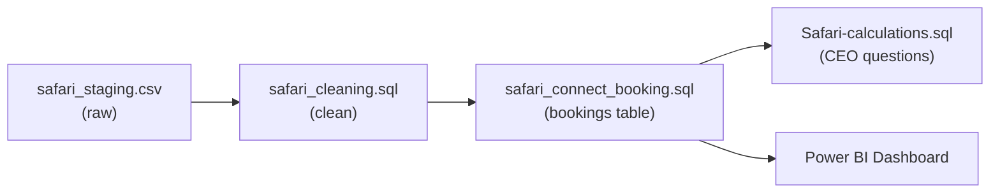
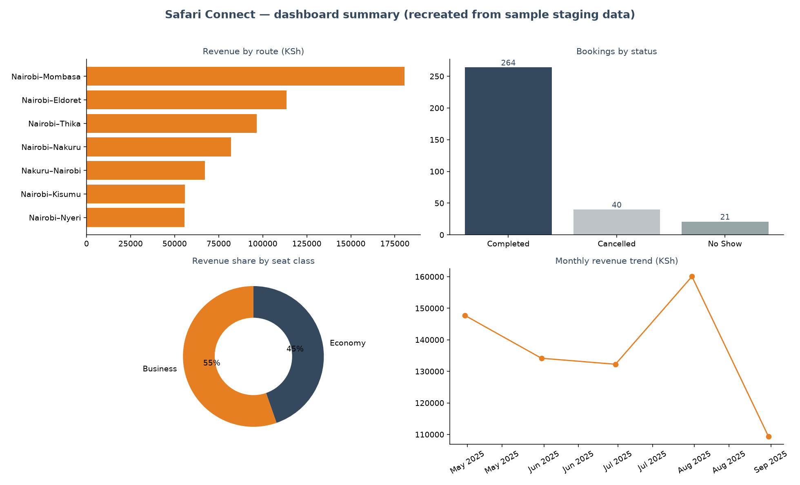

# Safari Travels project

Safari Connect runs intercity coach bookings, and the CEO needs to know which routes actually make money: which routes earn the most revenue, which are most popular with passengers, and which convert each seat sold into the most cash. This project answers those questions (plus a driver-performance leaderboard) from raw booking exports, using PostgreSQL for the pipeline and a Power BI dashboard on top.

Whats in here
|File            | what it represents                                                                                             |
|----------------|----------------------------------------------------------------------------------------------------------------|
|`safari table stanging.sql` | Creates the staging table and loads the raw booking export exactly as it arrives - all text, all dirty |
|`safari_cleaning.sql`       | Cleans the staging data: normalizes names, phones (+254 → 0), genders, seat classes, payment methods, statuses, four competing date formats, fare strings like 'KSh 1,200', and removes rating outliers, negative seat rows and duplicates |
|`safari_connect_booking.sql`| Loads the cleaned rows into the production `bookings` table, typing every column properly |
|`Safari-calculations.sql`   | The CEO questions: revenue by route, most popular route, revenue per seat sold, and driver rankings by revenue and passenger rating |
|`safari_dashboard.pbix`     | Power BI dashboard built on the production tables |

### The data
---
`safari_staging.csv` - 342 rows, 21 columns
One row per booking: passenger, route, vehicle, driver, seat class, fares and payment details, exactly as a booking-system export looks before anyone modeled it. Names, phones, dates, fares and statuses all carry real-world mess on purpose.

> Note: the original booking export was lost; this staging CSV is schema-faithful sample data regenerated by `scripts/generate_sample_data.py` (deterministic). The SQL pipeline and dashboard remain the real deliverables.

### Data Pipeline Flow

### Key findings (from the pipeline output)
---
- **Nairobi–Thika** is the most popular route by completed bookings — high frequency, low fare.
- **Nairobi–Mombasa** earns the most revenue overall and the most **per seat sold** — the long-distance routes pay.
- **Business class drives 55% of revenue** from a minority of bookings — worth protecting.
- Cancellations don't track fare: the priciest route (Nairobi–Kisumu, avg KSh ~5,600) also cancels most (40% of bookings), while the cheap Thika routes cancel least (~20%) — so revenue forecasts should discount Kisumu hardest.

### Dashboard summary
---

The image above is a matplotlib recreation of the dashboard's headline views, generated from the same pipeline output by `scripts/make_dashboard_summary.py`. The full interactive dashboard is `safari_dashboard.pbix`.

### How to run it
------

- [x] Create the staging table and load `safari_staging.csv` into it (all text columns).
- [x] Run `safari_cleaning.sql` to normalize the mess in place.
- [x] Run `safari_connect_booking.sql` to build and populate the production `bookings` table.
- [x] Run `Safari-calculations.sql` for the route and driver analysis.
- [x] Connect Power BI (Get Data → PostgreSQL) to `safari_connect`, load `safari_dashboard.pbix`, and refresh.

### Tools
---
PostgreSQL · DBeaver · Power BI Desktop · SQL (CTEs, window functions, views)

### Author
----
  Erickson
